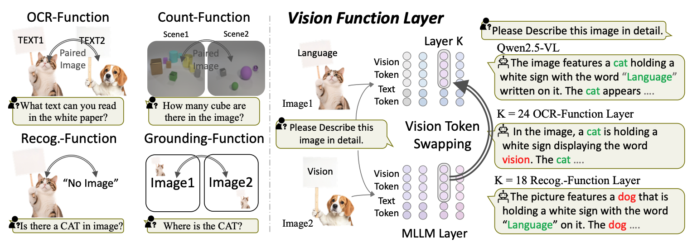

# Vision-Function-Layer in Multimodal LLMs



:warning: The `transformers` package version should be exactly as `4.51.3` or you should modify the vision token swapping code based on your own version.

# Vision Token Dropping

This repository contains the implementation of **Vision Token Dropping**.  
For detailed explanation and code, please refer to the [Vision-Token-Dropping](./Vision-Token-Dropping) folder.

---

## 🚀 Experiments
All experiments are conducted under the **VFL-LoRA** setup.  
Please check out our [VFL-LoRA](./VFL-LoRA/) for the base code and environment setup.

---

## ✅ TODO List
- [ ] Training data for VFL-LoRA  
- [✅] Open-Source Code
- [✅] Publish [arXiv Paper](https://www.arxiv.org/abs/2509.24791)  


---

## Citation

If you find this work useful, please cite our paper:
```
@article{shi2025vision,
  title={Vision Function Layer in Multimodal LLMs},
  author={Shi, Cheng and Yu, Yizhou and Yang, Sibei},
  journal={arXiv preprint arXiv:2509.24791},
  year={2025}
}
```
